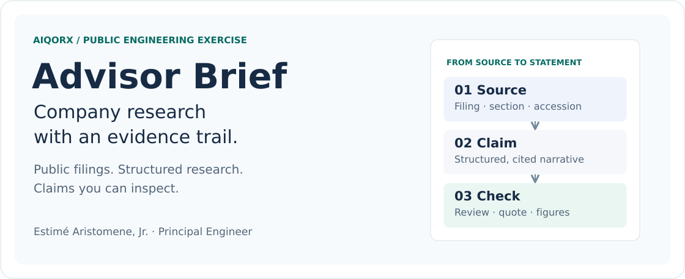
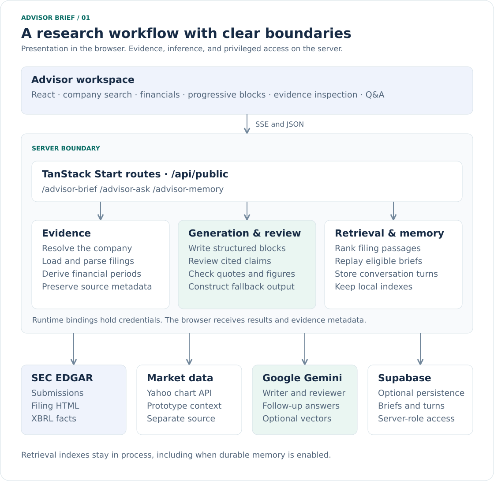
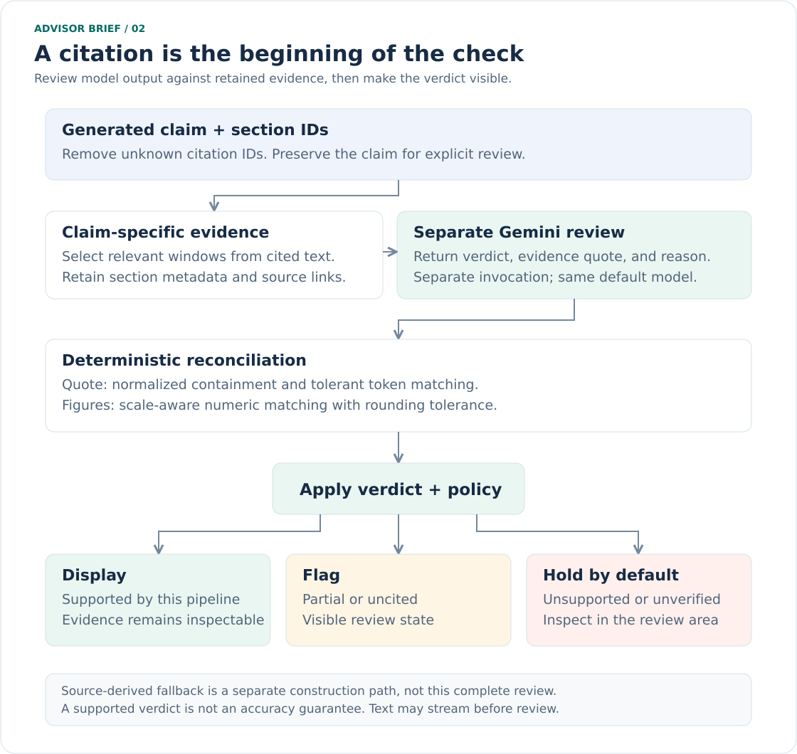
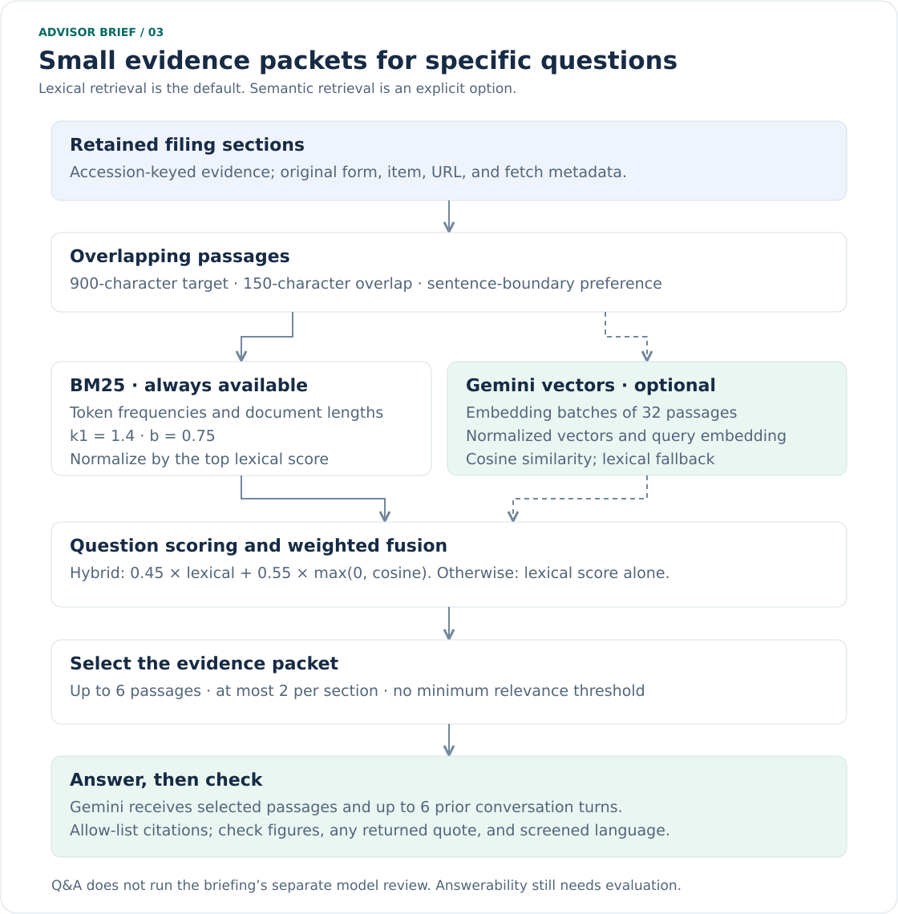

<p align="center">
  
</p>

<p align="center">
  <a href="https://ai-prototype-advisor-brief.lovable.app/">Explore the application</a> ·
  <a href="https://www.figma.com/design/fD6W8sS8wV8ULVIsClo4sw/Advisor-Brief---AI-Prototype?node-id=0-1">Figma design</a> ·
  <a href="docs/Advisor_Brief__Deck.pptx">Product presentation</a> ·
  <a href="SECURITY.md">Security policy</a>
</p>

# Advisor Brief

An advisor has a client call in ten minutes. The client wants to discuss a company the advisor has not reviewed recently. Reading the filings takes time; accepting a fluent summary without checking its sources creates a different problem.

Advisor Brief explores that moment. Enter a ticker or company name to assemble a market snapshot, filed financials, six briefing sections, and follow-up answers. The application keeps the supporting filing close to the statement: form, item, accession number, source URL, and the checks applied to the claim.

**This repository is a public software engineering and product design exercise.** It demonstrates an approach to building an inspectable AI research workflow, including the behavior when generation, review, or retrieval is incomplete. It is a prototype for evaluation and discussion—not an investment recommendation service, a client-distribution system, or evidence of regulatory approval.

The engineering question is simple: **what should the software require before it presents a generated statement as supported?** The answer here combines constrained evidence, a separate model review, deterministic checks, explicit display policies, and a fallback constructed from source data. Each mechanism has limits; those limits are part of the design discussion below.

## Read this repository

| If you are evaluating… | Start here                                                                                                        |
| ---------------------- | ----------------------------------------------------------------------------------------------------------------- |
| Product judgment       | [The exercise](#the-exercise) and [the advisor workspace](#the-advisor-workspace)                                 |
| System design          | [Architecture](#architecture) and [the request lifecycle](#the-request-lifecycle)                                 |
| AI reliability         | [Claim review](#claim-review) and [failure behavior](#failure-behavior)                                           |
| Retrieval and state    | [Follow-up questions](#follow-up-questions) and [memory and freshness](#memory-and-freshness)                     |
| Running the code       | [Local development](#local-development), [configuration](#configuration), and [verification](#verification)       |
| Production readiness   | [Security boundaries](#security-boundaries) and [production work still required](#production-work-still-required) |

## The exercise

The task is deliberately narrow: help an advisor get oriented in public company filings and inspect the basis for a statement before relying on it. The application exposes enough of its working state to make the exercise reviewable.

| Capability        | Implemented approach                                                  | Engineering purpose                                           |
| ----------------- | --------------------------------------------------------------------- | ------------------------------------------------------------- |
| Company research  | SEC resolution, submissions, selected filing sections, and XBRL facts | Turn heterogeneous public data into a usable research context |
| Brief generation  | One streamed Gemini request for six structured sections               | Deliver progressively through a bounded output contract       |
| Claim review      | Separate Gemini invocation, then quote and figure checks              | Treat the review model as another component to verify         |
| Continuity        | Filing Digest and a source-derived briefing path                      | Preserve useful work through model unavailability             |
| Follow-up answers | BM25, optional embeddings, citations, and conversation context        | Answer from a defined evidence corpus                         |
| State             | Accession-based keys, replay, and optional Postgres persistence       | Separate reusable evidence from conversation history          |
| Interface         | Responsive research workspace with visible evidence states            | Make system behavior understandable to the user               |

The six narrative sections are a **60 second summary**, **what changed since last quarter**, **top risks**, **recent 8-K events**, **talking points**, and **questions the client may ask**. Their contracts live in [`research.ts`](src/server/advisor/research.ts). They combine paragraphs, cited items, dated events, and question/answer pairs rather than forcing every output into an unstructured chat transcript.

There is no measured claim here about advisor productivity, investment outcomes, production accuracy, or guaranteed completion time. “60 second summary” describes a reading format, not a latency benchmark. The product deck supplies proposal context; it does not establish a deployed institutional pilot.

### Demonstration sequence

1. Request a briefing for a supported SEC registrant, such as `NVDA`.
2. Watch identity, filing inventory, financials, and the Filing Digest arrive before the narrative finishes.
3. Open a claim's evidence details. Compare its wording, source, reviewer quote, numeric checks, and verdict.
4. Ask “What does management say about supply?” Inspect the retrieved passages and linked sources.
5. Ask “Should I buy this stock?” The implemented detector refuses this example before inference.
6. Request the company again to inspect replay, or use `fresh=1` on the briefing endpoint to bypass briefing replay.

Use public company questions only. These demonstration routes do not establish authenticated advisor identities or a confidential client workspace.

## Architecture

<p align="center">
  
</p>

The browser owns presentation and interaction. TanStack Start server routes own evidence acquisition, model calls, policy decisions, and memory access. The custom server entry registers runtime bindings before loading the application handler, keeping privileged credentials outside the frontend build.

| Boundary              | Responsibility                                                                    | Source                                                                                                                       |
| --------------------- | --------------------------------------------------------------------------------- | ---------------------------------------------------------------------------------------------------------------------------- |
| Workspace             | Search, streaming state, charts, evidence inspection, questions, theme preference | [`src/routes/index.tsx`](src/routes/index.tsx)                                                                               |
| Orchestration         | Sequence the brief, answer follow-ups, expose recent memory                       | [`src/routes/api/public/`](src/routes/api/public/)                                                                           |
| Research components   | Acquire, parse, generate, review, retrieve, screen, remember                      | [`src/server/advisor/`](src/server/advisor/)                                                                                 |
| Runtime configuration | Read server bindings and configure inference                                      | [`src/server.ts`](src/server.ts), [`runtime-env.ts`](src/server/runtime-env.ts), [`config.ts`](src/server/advisor/config.ts) |

Gemini is called directly through Google's OpenAI-compatible HTTP interface. “OpenAI-compatible” describes the request format; it does not mean OpenAI serves the model. The configured provider is Gemini. The Lovable build integration supplies application tooling, not the inference gateway.

### Explicit orchestration

The repository divides responsibilities often called “agents”: evidence acquisition, research, review, retrieval, guardrails, and continuity. These are bounded functions and request stages. They do not autonomously choose tools, plan arbitrary tasks, or run as independently deployed services.

The main route makes ordering visible. It loads evidence, streams the writer, recovers missing blocks sequentially, requests a whole-brief review, and then builds the retrieval index. This avoids starting competing model work simply because it can be parallelized. Independent source fetches still run concurrently.

The normal complete generation path uses one writer call and one review call. That is a **logical call budget**, not a guaranteed count of HTTP attempts: retries, model fallback, and missing-block regeneration can add requests. Embeddings are off by default; factual follow-ups normally use one answer call after retrieval.

## The request lifecycle

[`advisor-brief.ts`](src/routes/api/public/advisor-brief.ts) is the orchestration entry point.

1. **Validate and admit.** Check the company query and the in-process client rate bucket. Invalid input returns JSON with HTTP `400`; a full bucket returns `429` before streaming starts.
2. **Resolve and load.** Resolve the SEC CIK, request submissions and Company Facts, and fetch market context. Select the latest exact `10-K` and `10-Q` forms plus `8-K` filings from the preceding 90 days.
3. **Consider replay.** Build a key from the canonical ticker and sorted accessions. An eligible cached briefing can be replayed with newly requested quote data and the current Company Facts result. Underlying source caches still apply.
4. **Deliver evidence first.** On a cache miss, emit filing metadata, financials, parsed-section metadata, and the Filing Digest. Useful source information arrives before generation succeeds or fails.
5. **Stream the writer.** Prepare bounded excerpts and request six structured blocks. A brace-aware parser reconstructs complete JSON objects across transport chunks; a network chunk is not assumed to equal a JSON object.
6. **Repair incomplete output.** Regenerate missing blocks sequentially with block-specific schemas. Report remaining incompleteness explicitly.
7. **Review and reconcile.** Gather the claims for a separate review invocation, then apply quote and figure checks. Emit block verdicts and an aggregate summary.
8. **Finish supporting state.** Build the retrieval index, send guardrail results and completion, and attempt to persist an eligible briefing. The `done` event precedes the memory write; it is not a durable-commit acknowledgment.

### Streaming is an evolving result

`block` events arrive before review, so generated text can be visible while verification is pending. Subsequent `validation` events update its display policy. A fallback may emit the same block name again to replace earlier content.

The current UI is therefore **not a strict publish-only-after-verification barrier**. A production workflow requiring that property would stage text until review completes. API consumers must also distinguish an HTTP error before streaming from an `error` event inside a stream that already returned HTTP `200`.

## Evidence acquisition and financial data

[`edgar.ts`](src/server/advisor/edgar.ts) implements the source adapters; [`pipeline.ts`](src/server/advisor/pipeline.ts) assembles their shared loading steps.

| Source                       | Material used                                                                      | Boundary                                                   |
| ---------------------------- | ---------------------------------------------------------------------------------- | ---------------------------------------------------------- |
| SEC company ticker data      | Company name, ticker, CIK                                                          | Registrant coverage, not universal instrument search       |
| SEC submissions              | Forms, dates, accessions, document locations                                       | Selection targets exact `10-K`, `10-Q`, and `8-K` forms    |
| Filing HTML                  | Annual business, risk factors, MD&A; quarterly MD&A and risks; current-report text | Heuristic extraction; sections can be missing or truncated |
| SEC XBRL Company Facts       | Revenue, net income, EPS, dividends, shares outstanding                            | Tag and period logic needs issuer-specific evaluation      |
| Yahoo Finance chart endpoint | Prototype price, volume, ranges, exchange, timestamp                               | Separate market context, not a licensed production feed    |

Each section preserves its ID, form, item, filing date, accession, URL, fetch timestamp, character count, and truncation flag. The UI can link back to the input used by the application.

### Two text budgets

Extraction retains up to 18,000 characters for business sections, 30,000 for risk factors, 45,000 for MD&A, and 6,000 for an `8-K` body. The writer gets a further bounded view: up to 12,000 characters per non-`8-K` section and 6,000 per `8-K`. Shortened views preserve roughly 70% from the beginning and 30% from the end.

This reduces quota and context pressure but may omit material in the middle. Quote and figure checks use the retained section text, which may itself be truncated—not necessarily the complete original filing. The number of filings can increase total request size; per-section limits are not a global token ceiling.

### Fiscal periods and derived values

The financial adapter identifies quarter-length and annual facts, keeps the latest filed value for a period, and can derive a fourth quarter by subtracting three reported quarters from an annual value. Candidate tags are selected by recency and coverage. Revenue, net income, and EPS expose up to eight quarterly points; dividends use up to four.

Market capitalization, trailing P/E, and dividend yield are computed when inputs exist. These can combine observations from different dates—for example, current price and shares outstanding from a filing. They are derived values, not exchange-certified measurements. Annual-minus-quarter arithmetic for per-share metrics and unusual fiscal calendars also needs more extensive evaluation.

## Claim review

<p align="center">
  
</p>

The central implementation is [`validation.ts`](src/server/advisor/validation.ts). A generated claim does not become supported merely because the writer supplied a citation.

### Citation integrity

The writer may cite only section IDs supplied for the request. Unknown IDs are removed and counted. This prevents a fabricated identifier from becoming a working citation, but does not establish that the remaining prose is correct. A claim without a surviving citation receives an `uncited` verdict.

### Separate review context

The reviewer receives claim IDs, claim text, and excerpts from each claim's cited sections. Its prompt forbids borrowing evidence from another claim. The default writer and reviewer model names are the same: “independent review” means separate invocation and context, not independence of model family or failure modes.

Excerpt selection scores windows for overlapping terms and numbers. The nominal evidence budget is 2,400 characters per claim, divided among cited sections with a 700-character minimum per section. Heavily cited claims can exceed that nominal budget. The whole review request grows with claim count.

### Check the reviewer, too

The model returns a verdict, quote, and reason. The server checks the quote against retained cited text, first through normalized containment and then through token-sequence tolerance for sufficiently long quotes. This accommodates extraction differences; it is not a strictly verbatim or cryptographic comparison.

Numeric checking extracts expressions, accounts for common scale words and filing units, and permits rounding at the claim's precision. A match establishes that a compatible value occurs in the evidence. It does not prove the correct metric, entity, period, sign, or accounting interpretation. Those relationships still depend on evidence and review quality.

### Verdicts and display policy

| Verdict       | Meaning here                                                             | Default treatment                     |
| ------------- | ------------------------------------------------------------------------ | ------------------------------------- |
| `supported`   | Reviewer support, a located quote, and no unmatched checked figures      | Display with evidence state           |
| `partial`     | Partial model support, or a supported verdict fails a quote/figure check | Display marked for review             |
| `unsupported` | Reviewer does not support the statement                                  | Hold with `VALIDATION_POLICY=exclude` |
| `uncited`     | No usable citation attached                                              | Display marked for review             |
| `unverified`  | No usable reviewer verdict                                               | Hide with `UNVERIFIED_POLICY=hide`    |

Output-screening flags can also hold narrative items. Held content remains inspectable in the review area. These are UI policies over transmitted content, not removal of every unsupported statement from the API response.

`supportedPct` reports the fraction of claims this pipeline classifies as supported. **It is not calibrated confidence, an accuracy benchmark, or a guarantee of correctness.** Source-derived output receives a different construction-based summary; its percentage is not comparable to measured model-review accuracy.

## Failure behavior

[`digest.ts`](src/server/advisor/digest.ts) implements two distinct non-generative outputs.

**Filing Digest** is assembled early from source metadata, XBRL-derived facts, recent filing events, and section information. It remains available when narrative features are unconfigured, provided source acquisition succeeds.

**Source-derived briefing** maps available facts, selected filing sentences, and fixed explanatory text into six section shapes. The orchestrator attempts it when a configured writer fails or no claim receives a usable independent review. It cannot manufacture missing source data, events, or reliable extraction.

| Condition                                 | Current behavior                                                               |
| ----------------------------------------- | ------------------------------------------------------------------------------ |
| No Gemini credential                      | Emit `research_failed`; retain source data and Filing Digest; no generated Q&A |
| Retryable provider failure                | Backoff and retry, then try configured Gemini candidates                       |
| Configured writer fails                   | Attempt source-derived briefing                                                |
| Narrative block missing                   | Sequential regeneration; report remaining incompleteness                       |
| No usable independent claim review        | Replace generated blocks with the source-derived path                          |
| Some claims lack review                   | Apply individual policies; partial review need not trigger full fallback       |
| Embedding batch/query fails               | Use lexical retrieval                                                          |
| Individual filing fails to load           | Continue with successfully parsed documents where possible                     |
| Required company/source acquisition fails | Emit a stream error; fallback cannot repair absent evidence                    |
| Market quote fails                        | Retain unavailable values rather than invent a price                           |
| Optional database fails initial probe     | Log the issue and use in-process memory                                        |

The source-derived path assigns `supported`/`verified` states by construction, sets `sourceDerived=true`, and does not run generated-claim quote and figure review. Some XBRL-derived statements link to a contextual filing section rather than the specific fact record. Typed provenance and distinct validation semantics remain necessary before regulated use.

### Transport and quota decisions

[`providers.ts`](src/server/advisor/providers.ts) retries HTTP `429`, server errors, and certain network failures. It honors `Retry-After` up to 30 seconds; otherwise it applies exponential backoff with jitter. Nonretryable HTTP responses stop retries for that candidate, but the outer chat loop can still attempt another model.

`AI_MAX_ATTEMPTS` is capped at five. Multiple chat candidates further limit attempts to two per candidate. Timeouts apply per attempt, so total latency can exceed a single timeout through retries and fallback. There is no distributed request queue or global deadline.

## Follow-up questions

<p align="center">
  
</p>

A brief summarizes selected sections; a question needs a smaller evidence set targeted to what was asked. [`retrieval.ts`](src/server/advisor/retrieval.ts) and [`advisor-ask.ts`](src/routes/api/public/advisor-ask.ts) implement that distinction.

### Retrieval mechanics

1. Split retained sections into passages targeting 900 characters, with 150 characters of overlap and a sentence-boundary preference.
2. Build BM25 token statistics with `k1=1.4` and `b=0.75`.
3. When embeddings are enabled, request vectors in batches of 32 and normalize them. A failed/incomplete batch discards the vector path for the index.
4. Score the query lexically; if vectors are available, embed the question and compute cosine similarity.
5. Rank by normalized lexical score, or `0.45 × lexical + 0.55 × max(0, cosine)` in hybrid mode.
6. Select up to six passages, with at most two from one section.

This is weighted score fusion, not reciprocal rank fusion. The section cap encourages variety without guaranteeing different filings. There is no minimum relevance threshold: weak questions can still retrieve low-value passages, so answerability requires evaluation.

### Answer construction

Recognized sensitive-data patterns and recommendation requests are handled before a model call. Admitted questions load the current filing key, reuse or rebuild the index, and send selected passages plus at most six prior conversation turns to Gemini. Its structured response includes text, citation IDs, a quote, and an `answerable` flag.

Returned citations are restricted to retrieved passage IDs. Quote and figure checks, answerability, and output screening produce `supported`, `review`, `not_in_filings`, or `compliance`. Refusals and provider failures use `refused` and `unavailable`. Follow-up answers do **not** receive the briefing's separate model review.

A current nuance: an absent follow-up quote produces `quoteFound=null`; only a failed quote check forces review. A `supported` answer therefore does not establish that a quote was returned and matched. If no citations survive, checks use all retrieved text while the verdict still requires review.

## Memory and freshness

[`memory.ts`](src/server/advisor/memory.ts) separates three kinds of state. The database adapter persists two; it does not turn retrieval into a managed vector database.

| State           | Key and bounds                                                       | Default              | Optional persistence                         |
| --------------- | -------------------------------------------------------------------- | -------------------- | -------------------------------------------- |
| Briefing replay | Uppercase ticker + sorted accessions; six-hour TTL; local cap of 100 | Warm-instance memory | `advisor_briefings` event record and summary |
| Conversation    | Sanitized session + ticker; last 12 turns, six supplied as context   | Warm-instance memory | `advisor_conversations` turn array           |
| Retrieval index | Filing key; local cap of 40 indexes                                  | Warm-instance memory | Still local with Supabase enabled            |

Newly observed accessions change the briefing key. Observation is not instantaneous: ticker lookup is cached for 24 hours, submissions and Company Facts for one hour, and filing documents for six hours. `fresh=1` bypasses replay, not these source caches.

Replay refreshes quote and financial events but retains the original narrative and other recorded events. Generation time and current data timestamps have different meanings; replay is not a new independent review.

Eligibility requires a nonfailed record with claims and a status other than `unverified`; it does not require every claim to be supported. Source-derived records can qualify. A current edge case after reviewer failure takes the stored summary from the first `validation_summary`, even when a later fallback supersedes it; that can prevent a recovered brief from replaying.

The optional migration enables RLS without browser policies; the adapter uses a server-side service-role credential. That protects direct table access but does not authorize callers of the public memory endpoint. Session IDs are grouping keys, not identity proof. Retention, atomic concurrent turn appends, tenant ownership, and audit-grade persistence remain production work.

## The advisor workspace

The interface follows the reading task: identify the company, establish the filing period, understand the business, and inspect uncertain statements. It combines market context, financial charts, narrative blocks, evidence details, held claims, and questions.

| Interface choice      | Purpose                                           | Implementation                                     |
| --------------------- | ------------------------------------------------- | -------------------------------------------------- |
| Progressive sections  | Make fetched facts useful while generation runs   | SSE events update separate state slices            |
| Evidence beside prose | Shorten the path from claim to source             | Filing links, reasons, quotes, figure checks       |
| Financial chart       | Inspect reported periods and trends               | Recharts over the derived quarterly series         |
| Review states         | Distinguish pending, supported, flagged, and held | Claim and block status components                  |
| Operational detail    | Make the exercise diagnosable                     | Pipeline state, retrieval mode, timing, guardrails |
| Theme preference      | Support different reading environments            | Dark first visit; persisted light selection        |

The [Figma file](https://www.figma.com/design/fD6W8sS8wV8ULVIsClo4sw/Advisor-Brief---AI-Prototype?node-id=0-1) is the linked design reference. React and TypeScript implement runtime behavior. This README's illustrations use an opaque light background for consistent contrast on GitHub; they do not change the application's dark-first default.

## API reference

All routes are public demonstration endpoints and handle `OPTIONS` through the shared CORS configuration.

| Method and route                 | Input                                         | Response                                                 |
| -------------------------------- | --------------------------------------------- | -------------------------------------------------------- |
| `GET /api/public/advisor-brief`  | Required `q`; optional `fresh=1`              | SSE stream, or JSON input/rate errors before streaming   |
| `POST /api/public/advisor-ask`   | JSON `ticker`, `question`, optional `session` | Answer/refusal, verdict, and available evidence metadata |
| `GET /api/public/advisor-memory` | Optional `ticker` and `session`               | Recent eligible briefings or selected conversation       |

Queries allow up to 64 characters from a defined character set. Normalized questions must be 3–600 characters. Session IDs allow letters, numbers, underscore, and hyphen, are limited to 64 characters, and default to `anon`. The briefing route does not use a session parameter; sessions belong to question and memory routes.

### Local examples

Use Vite's printed address; these examples assume port `5173`.

```bash
curl -N 'http://localhost:5173/api/public/advisor-brief?q=NVDA&fresh=1'

curl 'http://localhost:5173/api/public/advisor-ask' \
  -H 'content-type: application/json' \
  --data '{"ticker":"NVDA","question":"What does management say about supply?","session":"readme-demo"}'

curl 'http://localhost:5173/api/public/advisor-memory?ticker=NVDA&session=readme-demo'
```

### Event contract

| SSE events                                                         | Interpretation                                                       |
| ------------------------------------------------------------------ | -------------------------------------------------------------------- |
| `resolved`, `filings`, `quote`, `financials`, `sections`, `digest` | Identity and source data                                             |
| `memory`, `status`                                                 | Replay information and progress                                      |
| `block`                                                            | Narrative block; a subsequent event can replace the same named block |
| `validation`, `validation_summary`                                 | Claim verdicts and aggregate review state                            |
| `index`, `guardrails`, `usage`                                     | Retrieval, screening, and recorded model usage                       |
| `research_failed`                                                  | Narrative unavailable/incomplete; source content may remain useful   |
| `done`, `error`                                                    | Completion or an in-stream error                                     |

Consumers should tolerate repeat blocks and multiple summaries, using the final applicable state. `usage` is not complete billing telemetry: the writer accumulator does not include every reviewer, embedding, fallback, or follow-up call.

## Technology stack

| Layer                | Repository technology                                       | Responsibility                                |
| -------------------- | ----------------------------------------------------------- | --------------------------------------------- |
| Application          | React 19, TanStack Start and Router                         | Workspace and server routes                   |
| Styling and controls | Tailwind CSS 4, Radix UI, Lucide                            | Tokens, layout, reusable controls             |
| Charts               | Recharts and SVG                                            | Financial and explanatory visuals             |
| Toolchain            | TypeScript, Vite 8, Nitro 3, Lovable TanStack configuration | Build and Cloudflare-targeted server output   |
| Inference            | Direct Gemini HTTP requests                                 | Writing, review, answers, optional embeddings |
| Evidence             | SEC EDGAR and XBRL Company Facts                            | Filing identities, text, reported facts       |
| Retrieval            | TypeScript BM25 and normalized vectors                      | Lexical and optional hybrid selection         |
| Persistence          | In-process maps; optional Supabase Postgres                 | Replay and conversation state                 |
| Verification         | Node test runner, `tsx`, TypeScript, scripted acceptance    | Regression and runtime checks                 |

[`package.json`](package.json) declares package ranges; [`bun.lock`](bun.lock) records the resolved set. Model defaults are repository configuration, not a promise of availability for every account.

## Local development

Use a current Node.js 22 release compatible with the locked toolchain and Bun for the committed lockfile. Generated narrative and Q&A need a Gemini credential; source-only behavior can be inspected without one. SEC and market requests require network access.

```bash
git clone https://github.com/iamestime/ai-prototype-advisor-brief.git
cd ai-prototype-advisor-brief
bun install --frozen-lockfile
cp .env.example .env.local
```

Edit `.env.local`, set server-side `GEMINI_API_KEY`, and replace `EDGAR_USER_AGENT` with an appropriate deployment contact identity. Start the application:

```bash
npm run dev -- --port 5173
```

Use the printed URL if your environment selects another port. Never prefix a Gemini or Supabase service-role key with `VITE_`; that prefix belongs to client build configuration.

For durable memory, review and apply the [existing migration](supabase/migrations/20260919000000_advisor_memory.sql) to a project you control, then set `MEMORY_BACKEND=supabase`, `SUPABASE_URL`, and `SUPABASE_SERVICE_ROLE_KEY`. Inspect the reported backend: a failed initial table probe selects local memory for that instance.

## Configuration

[`config.ts`](src/server/advisor/config.ts) is authoritative; [`.env.example`](.env.example) is the starting template. Runtime bindings override process environment values.

### Models and pacing

| Variable             | Repository default                                             | Purpose                                                              |
| -------------------- | -------------------------------------------------------------- | -------------------------------------------------------------------- |
| `GEMINI_API_KEY`     | Unset                                                          | Server credential                                                    |
| `GEMINI_BASE_URL`    | `https://generativelanguage.googleapis.com/v1beta/openai`      | Direct transport; smoke harness substitutes a local mock             |
| `AI_MODEL`           | `gemini-3.8-flash`                                             | Requested writer/follow-up model                                     |
| `AI_FALLBACK_MODELS` | `gemini-3.8-flash,gemini-3.5-flash-lite,gemini-3.1-flash-lite` | Ordered chat candidates after deduplication                          |
| `VALIDATOR_MODEL`    | `gemini-3.8-flash`                                             | Requested reviewer                                                   |
| `EMBED_MODEL`        | `gemini-embedding-001`                                         | Optional embedding model                                             |
| `ENABLE_EMBEDDINGS`  | `false`                                                        | Enable semantic retrieval                                            |
| `AI_MAX_ATTEMPTS`    | `4`                                                            | Attempt setting, capped at five and further limited for chat ladders |
| `AI_CALL_GAP_MS`     | `750`                                                          | Pause before review, capped at 5,000 ms                              |

Choose model IDs available to your account. Some response metadata uses the requested model name even after fallback; it is not a complete record of the actual model serving every stage.

### Policies and state

| Variable                    | Default                      | Purpose                                          |
| --------------------------- | ---------------------------- | ------------------------------------------------ |
| `VALIDATION_POLICY`         | `exclude`                    | Hold unsupported claims; optional `flag`         |
| `UNVERIFIED_POLICY`         | `hide`                       | Hide unverified claims; optional `flag`          |
| `RESEARCH_TIMEOUT_MS`       | `120000`                     | Writer attempt timeout                           |
| `VALIDATOR_TIMEOUT_MS`      | `75000`                      | Reviewer attempt timeout                         |
| `ASK_TIMEOUT_MS`            | `60000`                      | Answer attempt timeout                           |
| `EMBED_TIMEOUT_MS`          | `30000`                      | Embedding attempt timeout                        |
| `RATE_LIMIT_BRIEFS_PER_10M` | `12`                         | Local briefing rate bucket                       |
| `RATE_LIMIT_ASKS_PER_10M`   | `40`                         | Local question rate bucket                       |
| `MEMORY_TTL_MS`             | `21600000`                   | Replay TTL, not a conversation-deletion policy   |
| `MEMORY_BACKEND`            | In-process unless `supabase` | Briefing/conversation adapter                    |
| `SUPABASE_URL`              | Unset                        | Optional database endpoint                       |
| `SUPABASE_SERVICE_ROLE_KEY` | Unset                        | Privileged server-only memory credential         |
| `EDGAR_USER_AGENT`          | Project contact identity     | SEC request identification                       |
| `DEBUG_ERRORS`              | `false`                      | Extra diagnostic details; keep disabled publicly |

`GEMINI_MODEL` is an alternate model input. Key lookup also accepts `GOOGLE_GENERATIVE_AI_API_KEY` and `GOOGLE_API_KEY`. Optional `VITE_SUPABASE_URL` and `VITE_SUPABASE_PUBLISHABLE_KEY` configure browser integration, not the privileged memory adapter.

## Verification

The focused tests and two acceptance harnesses have different scopes. Passing one does not establish the others.

```bash
npm test
npm run typecheck
npm run build
```

`npm test` runs tracked-file secret checking and then the Node suite with the installed `tsx` loader. [GitHub Actions](.github/workflows/quality.yml) installs from `bun.lock` and runs secret checking, tests, type-checking, and a build on pull requests and `main` pushes.

| Test                                                               | Focus                                                                                        |
| ------------------------------------------------------------------ | -------------------------------------------------------------------------------------------- |
| [`research-parser.test.ts`](tests/research-parser.test.ts)         | Context limits, schemas, stream boundaries, empty blocks, invented citations, markup cleanup |
| [`validation.test.ts`](tests/validation.test.ts)                   | Scale/rounding examples, quote location, evidence windows, whole-brief review                |
| [`gemini-transport.test.ts`](tests/gemini-transport.test.ts)       | Throttling, model fallback, local streamed fixtures                                          |
| [`deterministic-brief.test.ts`](tests/deterministic-brief.test.ts) | Source-derived six-block constructor with fixture data                                       |
| [`runtime-config.test.ts`](tests/runtime-config.test.ts)           | Runtime binding precedence and provider selection                                            |
| [`theme.test.ts`](tests/theme.test.ts)                             | Dark-first initialization and persisted light selection                                      |

These are regression checks, not a labeled financial-research benchmark. They do not establish exhaustive issuer coverage, adversarial robustness, accessibility conformance, or production latency.

### Local integration smoke

```bash
bash scripts/smoke-local.sh
```

Explicit `bash` works with the script's currently tracked nonexecutable mode. The harness starts a Gemini-compatible mock and the application, while retaining real SEC and market requests. It checks streamed blocks, review output, optional hybrid retrieval, a sourced answer, and refusal behavior. It is neither offline nor a test of live Gemini quality.

### Live acceptance

```bash
npm run test:live
```

[`live-acceptance.mjs`](scripts/live-acceptance.mjs) defaults to the linked deployment and fresh briefings for `LLY`, `BA`, `NVDA`, and `ORCL`. It expects six block names, a completed Gemini review, numeric evidence coverage, a sourced factual answer, and a recommendation refusal before inference. `LIVE_BASE_URL`, `LIVE_TICKERS`, and `LIVE_COOLDOWN_MS` customize the run.

This harness makes real requests and may incur inference costs. Source-derived fallback intentionally does not count as a successful Gemini-review acceptance result. The run tests the serving deployment, not automatically the local checkout.

## Security boundaries

Keep credentials in ignored local environment files or protected server runtime bindings. Gemini credentials and the optional service-role key are read server-side. [SECURITY.md](SECURITY.md) covers reporting and handling; [`check-secrets.mjs`](scripts/check-secrets.mjs) checks tracked files for prohibited runtime files and common credential signatures.

Implemented controls include input validation, regex-based sensitive-data and advice detection, source-line sanitization, citation allow-listing, output screening, and local rate limiting. They address specific failure modes but do not establish complete prompt-injection, personal-data, or recommendation detection.

The public routes have permissive CORS and no authenticated advisor requirement. Local rate limits do not coordinate replicas; SEC request pacing is not deployment-wide concurrency control. Server-only database credentials do not turn client-selected session keys into authorization. Use public, nonconfidential inputs for this exercise.

## Production work still required

The next steps should make these boundaries enforceable under concurrent users, incomplete evidence, and independently measured failures.

| Area                    | Current boundary                                                | Production acceptance criterion                                                      |
| ----------------------- | --------------------------------------------------------------- | ------------------------------------------------------------------------------------ |
| Identity                | Public routes; client-selected sessions                         | Authenticated users, tenant-scoped memory access tests                               |
| Publication             | Blocks can appear before review                                 | Explicit staging/release for content requiring prior verification                    |
| Provenance              | Fallback assigns verification states; some links are contextual | Typed XBRL fact references; distinct generated/extracted/calculated validation       |
| Review quality          | Same model family; heuristic checks                             | Labeled claims, issuer diversity, adversarial evaluation, false-support measurements |
| Filing coverage         | Selected forms, heuristic extraction, truncation                | Measured coverage, amendments, unsupported-issuer behavior                           |
| Retrieval               | Fixed weights; no relevance threshold                           | Evaluated recall, abstention, versioned indexes                                      |
| Budgets                 | Per-attempt deadlines and local pacing                          | Global deadlines, cancellation, distributed quotas, spend accounting                 |
| Memory                  | Nontransactional appends; fallback summary edge case            | Atomic writes, retention, final-state replay, concurrency tests                      |
| Observability           | Partial usage/model metadata                                    | Actual served model IDs, full usage, traces, SLOs, recovery exercises                |
| Market data             | Prototype endpoint                                              | Approved feed, freshness policy, unavailable/stale behavior                          |
| Delivery and governance | Demonstration controls, focused tests                           | Security review, accessibility evaluation, model-risk ownership, retention approval  |

An adapter, prompt, or configuration option alone does not establish that these criteria are met.

## Repository guide

| Path                                                                                                              | Responsibility                                          |
| ----------------------------------------------------------------------------------------------------------------- | ------------------------------------------------------- |
| [`src/routes/index.tsx`](src/routes/index.tsx)                                                                    | Workspace, streaming client, claim policies, follow-ups |
| [`src/routes/api/public/advisor-brief.ts`](src/routes/api/public/advisor-brief.ts)                                | Orchestration, fallback, SSE, replay                    |
| [`src/routes/api/public/advisor-ask.ts`](src/routes/api/public/advisor-ask.ts)                                    | Retrieved answers and conversation updates              |
| [`src/routes/api/public/advisor-memory.ts`](src/routes/api/public/advisor-memory.ts)                              | Recent briefings and conversation reads                 |
| [`src/server/advisor/edgar.ts`](src/server/advisor/edgar.ts)                                                      | SEC, extraction, XBRL periods, quotes                   |
| [`src/server/advisor/research.ts`](src/server/advisor/research.ts)                                                | Context, block contracts, parsing, regeneration         |
| [`src/server/advisor/validation.ts`](src/server/advisor/validation.ts)                                            | Evidence preparation, review, checks, summaries         |
| [`src/server/advisor/retrieval.ts`](src/server/advisor/retrieval.ts)                                              | Chunks, BM25, vectors, score fusion                     |
| [`src/server/advisor/memory.ts`](src/server/advisor/memory.ts)                                                    | In-process and Postgres adapters                        |
| [`src/server/advisor/guardrails.ts`](src/server/advisor/guardrails.ts)                                            | Input, source, output, rate checks                      |
| [`src/server/advisor/digest.ts`](src/server/advisor/digest.ts)                                                    | Filing Digest and continuity construction               |
| [`src/server/advisor/config.ts`](src/server/advisor/config.ts), [`providers.ts`](src/server/advisor/providers.ts) | Runtime settings and model transport                    |
| [`src/server.ts`](src/server.ts), [`runtime-env.ts`](src/server/runtime-env.ts)                                   | Server entry and binding bridge                         |
| [`supabase/migrations/`](supabase/migrations/)                                                                    | Optional memory schema                                  |
| [`scripts/`](scripts/), [`tests/`](tests/)                                                                        | Secret gate, regression tests, acceptance harnesses     |
| [`docs/readme/`](docs/readme/)                                                                                    | Editable light-mode SVGs and their generator            |

## Deployment and change discipline

The connected application builds from GitHub. [`AGENTS.md`](AGENTS.md) requires preserving published history; use additive commits and reviewed merges. The Nitro target comes from [`vite.config.ts`](vite.config.ts) and the installed TanStack configuration.

For runtime releases, verify the locked install, tests, type-check, build, and relevant integration gates; configure server secrets; then inspect the served deployment and live behavior. A merged commit is not proof that hosting finished. Documentation-only changes can be reviewed through rendered assets, links, and source checks without an inference acceptance run.

## Project lead

**Estimé Aristomene, Jr.**<br>
Managing Director, Principal Engineer · **AiQorx**<br>
[GitHub](https://github.com/iamestime) · [Contact AiQorx](https://aiqorx.com/contact)

Advisor Brief is a public exercise in product judgment, applied AI, and software architecture. The code, design reference, and [presentation](docs/Advisor_Brief__Deck.pptx) let reviewers examine the decisions, reproduce the workflow, and challenge the tradeoffs.
